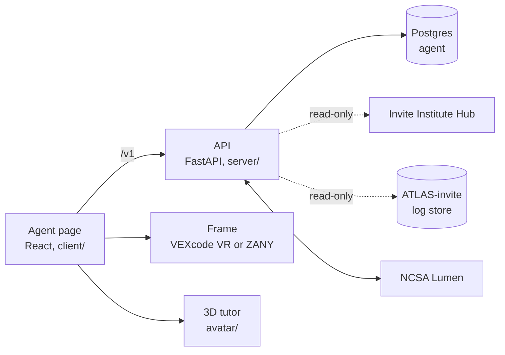

# Architecture

The agent is a FastAPI server with its own Postgres, and a React page that nginx serves. On the
INVITE server they run at agent.inviteai.org.

## The Parts

| Path | What is there |
| --- | --- |
| `server/agent/api.py` | the `/v1` routes |
| `server/agent/app.py` | the app, the Turnstile gate, `/healthz` and the background threads |
| `server/agent/environments/` | one module per environment, with its frame, its log source and its playgrounds |
| `server/agent/situation.py` | the measurements, and the facts in words for the prompt |
| `server/agent/pedagogy.py` | feedback classes, question types and the prompt |
| `server/agent/feedback.py` | the one pipeline that questions and check-ins share |
| `server/agent/checkins.py` | the check-in daemon |
| `server/agent/speech.py` | the tutor's voice and spoken questions |
| `server/agent/study.py` | ATLAS's study tickets |
| `server/agent/gate.py` | the Turnstile gate and the token budgets |
| `server/vendor/agent-lm-packages` | the shared learner-model engine (a git submodule) |
| `server/migrations/` | the schema, applied when the API starts |
| `client/` | the page, in React, dressed like ZANY and VEXcode VR |
| `avatar/` | the 3D tutor's page, and where its Unity build is installed |

## What Runs In The Background

When the API starts, it checks `ENVIRONMENTS` names only environments it knows, so a typo fails
the start and not the first request. Then it starts these threads.

- A watcher for each ZANY environment, which listens for ATLAS's deletions and checks once an hour
  for any it missed.
- The check-in daemon, when `CHECKINS_ENABLED` is on. [Check-Ins](check-ins.md) explains it.
- A warm-up of the tutor's voice, so the first student doesn't wait a second for it.

## What The Agent Keeps

A student is `(environment, student_key)`. [Environments](environments.md) says how each one
makes the key.

| Table | What it holds |
| --- | --- |
| `events` | each student's learner logs, copied from their environment's source. A record read twice is kept once. |
| `ingest_cursors` | where to resume reading each source |
| `messages` | the chat. Agent replies keep the situation, prompt, model, settings and tokens that made them. |
| `ratings` | thumbs and notes on replies |
| `triggers` | behavior triggers the daemon found, each kept once |
| `llm_usage` | one row per LLM call, for the token budgets |
| `agent_settings` | a researcher's settings for a student's check-ins |
| `schema_migrations` | which migrations have run |

Researchers' chats stay apart from students'. A message's `chat` is `student` or `research`, so an
experiment never becomes part of the chat a student's reply reads.

## The Gate

The agent has no login. Before any `/v1` call, a browser solves a Cloudflare Turnstile check once,
and the server remembers it in a signed cookie for 12 hours. A study student's ticket from ATLAS
passes the gate too, since ATLAS signed them in.

That cookie is also the browser session the token budget counts against. By default a session may
spend 150,000 LLM tokens and the whole site 3,000,000 a day, check-ins included.
[Configuration](../guides/configuration.md#the-gate-and-the-budgets) has the settings.
