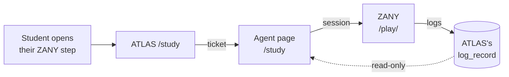

# ZANY In An ATLAS Study

In an ATLAS study a researcher chooses, student by student, who codes with the agent. A student
with the agent sees ZANY inside the agent page. Everyone else sees plain ZANY. So a study can
compare the two groups.

The researcher's side is in ATLAS's docs, under
[Running A Study](https://docs.inviteai.org/atlas/guides/running-a-study/).

## Who Gets The Agent

ATLAS frames the agent only when all three hold.

- The researcher ticked "With the INVITE Agent" on the student.
- ATLAS may keep the student's data. A student who declined, stopped, or whose study is paused gets
  plain ZANY.
- ATLAS has the shared secret in its site config.

## The Ticket

Nobody signs in to the agent here. ATLAS puts a ticket in the link, after the `#`, so the browser
doesn't send it when it loads the page. The ticket names the study, the study code, the participant
ID and the study session, and it lasts 12 hours.

It is the payload as base64url JSON, a dot, then the HMAC-SHA256 of that text in hex, signed with a
secret only ATLAS and the agent hold. The agent calls it `AGENT_STUDY_SECRET`, and ATLAS calls it
`agent_study_secret`. `server/agent/study.py` reads it.

The page sends the ticket with every call, in the `X-Study-Ticket` header, or as `?ticket=` on the
check-in stream and on the tutor's voice clips, where the browser or Unity can't set headers. The
server takes the student from the ticket and never from the link. A request with a missing, forged
or expired ticket, or one whose student doesn't match the ticket's, gets a 403. A valid ticket also
passes the Turnstile gate, and the token budget counts per ticket.

## What The Student Sees

The same page as anywhere else, with ZANY in the frame and the study's step bar from ATLAS above
it. There is no sign-in form and no Sign out button. When they press "I'm finished" in ATLAS, ATLAS
asks the ZANY frame inside the agent page to send its last logs, then moves them on.

## The Logs

ZANY logs study sessions into ATLAS's `log_record` table. The `zany-study` environment reads a
student's rows from there, keyed like ZANY's link students, by study code and participant ID, but
kept apart from them.

It copies logs only for students who have opened the agent. A student who never had it is never
read.

## Deleting A Student

When ATLAS deletes a student's logs, it sends `zany_forgotten` with the study, the participant and
the study code. The agent then deletes everything it keeps about that student, the chat included.
An hourly check catches a deletion it missed while it was down.

## Setting It Up

1. Put the same long random secret in the agent's `AGENT_STUDY_SECRET` (in `/etc/agent/zany.env` on
   the INVITE server) and in ATLAS's `agent_study_secret` (`bench set-config`).
2. Give the agent's read-only login `SELECT` on `log_record`.
3. Add `zany-study` to `ENVIRONMENTS`.
4. Let ZANY's site be framed by agent.inviteai.org, with
   `Content-Security-Policy: frame-ancestors 'self' https://agent.inviteai.org`.

The INVITE server has all four. InviteInstitute/infra keeps the nginx header and the grant.
