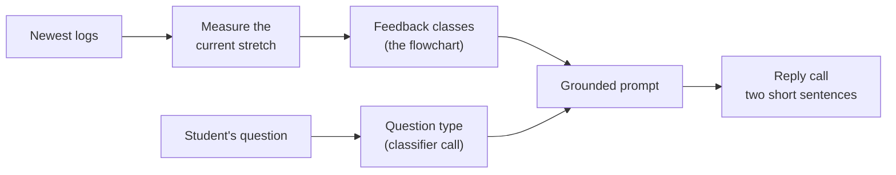

# How A Reply Is Made

A typed question, a spoken one, the Help button and a check-in all go through one pipeline in
`server/agent/feedback.py`. So the pedagogy is the same on all of them. Only the inputs differ.

## The Steps

1. The server reads the student's newest logs from their environment's source, so the reply sees
   the run they just made. If the source is down, the reply works from what the agent already
   keeps.
2. It measures the current playground stretch of the session. That is the run of events since the
   student last opened or switched a playground. The measurements are progress toward the goal,
   the work pattern, persistence and the last error the robot reported.
3. The study's flowchart turns the work pattern and persistence into feedback classes. They decide
   how the reply sounds.
4. A small classifier call sorts the question into one of four question types. Each has its own
   scaffolding, which decides what the reply says next.
5. One reply call gets the student's actual program, the measured facts in plain words, the recent
   chat, the scaffolding and the feedback classes. It writes at most two short sentences.

The server then trims the reply to two sentences and 40 words, and drops any label the model
leaked, like a feedback class's name. A reasoning model's thinking is cut too.

## When The Agent Answers Without The Model

Some questions get a fixed answer, with no LLM call.

| When | The answer |
| --- | --- |
| The student has no logs yet | "Run your project once so I can see your code, then ask me again." |
| Their playground is one the agent doesn't know | It names the playgrounds it can help with. |
| A run is still going | It asks them to press Stop, then ask again. |

## The Measurements

They come from `server/agent/situation.py` and are measured from events, never guessed.

| Measurement | What it says |
| --- | --- |
| Progress | 0 to 100 toward the playground's goal, from the run's playground data. A playground with nothing to score, like ZANY's Art Canvas, has none. |
| Work pattern | Trial and error, snap and test, step-by-step elimination, steady development (with progress going up, flat or down), long stalled progress or code abandonment. |
| Persistence | Expected completion, high persister, early quitter or still in progress. |
| Last error | The newest error message the robot reported. |
| Milestones | The playground's own checkpoints the student has reached. |

## Feedback Classes

There are fourteen, from the study. The flowchart in `server/agent/pedagogy.py` picks them from
the work pattern and persistence.

| Work pattern | Feedback classes |
| --- | --- |
| Long stalled progress | Error Flagging |
| Development, progress going up | Elaborate |
| Development, progress flat | Reassure |
| Development, progress going down, or snap and test | Inform |
| Trial and error | Partial Correctness, plus Evidence-Based Praise, Reassure or How To by persistence |
| Code abandonment | Encourage Testing (Diagnose), or Reassure and Elaborate for a high persister |
| Step-by-step elimination | Hint |
| Nothing fits | Question |

The others are Positive Feedback, Corrective Guidance, Remind and Next Step. Each class carries a
description and examples, which go into the prompt.

## Question Types

The classifier answers with one number. An answer it can't read, or a classifier that takes more
than six seconds, means General.

| Question type | Covers | Scaffolding |
| --- | --- | --- |
| Task / Goal Understanding | what the task is, the rules, the scoring, where things are | clarify one fact, then tie it to one immediate goal |
| Action / Strategy / Solution Support | which block, how to do something, asking for code | the least specific support that fits, more only after attempts that didn't work |
| Debugging / Problem Diagnosis | something that doesn't work as expected | goal, expected, actual, then one hypothesis and one test |
| General / Unclear Help-Seeking | "Help", "idk", off-task messages | one choice question about what kind of help they need |

None of them ever hands over the complete program.

## What Is Kept

Each agent message in `messages` keeps its `context`, which holds the situation, the model, the
prompt, the settings and the tokens. A researcher can always read why the agent said what it said.
[Architecture](architecture.md#what-the-agent-keeps) lists the tables.
