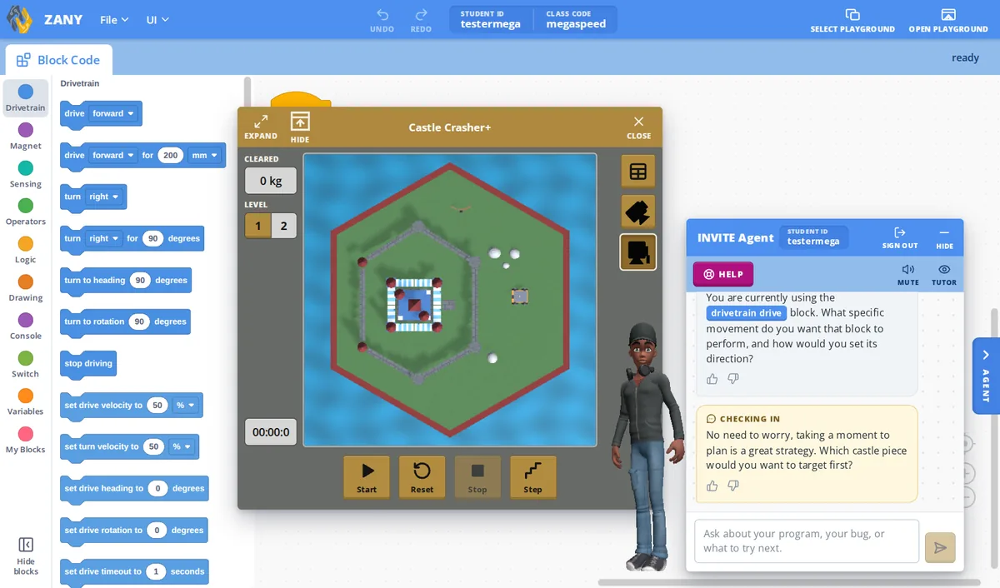
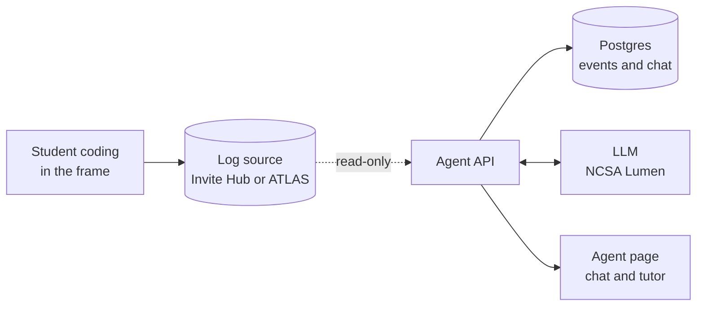

# INVITE Agent

The INVITE Agent is a tutor for middle school students who code robots in block-based
environments. Its page frames the student's coding space and floats a chat on top of it. When a
student asks for help, or looks stuck, the agent reads what their code and their robot are
actually doing and gives one short, specific hint.

It runs at [agent.inviteai.org](https://agent.inviteai.org).

## Where It Works

Each site picks which environments it serves. All of them log in VEXcode VR's format, so the
measurements, the pedagogy and the chat are the same in each. Only the log source differs.

| Environment | What the page frames | Where the student's logs come from |
| --- | --- | --- |
| VEXcode VR | `research-vr.vex.com` | the Invite Institute Hub |
| ZANY | `vr.inviteai.org`, with the student's class and ID in the link | ATLAS-invite's link records |
| ZANY in an ATLAS study | `zany.inviteai.org/play/` for the student's study session | ATLAS-invite's study logs |

In an ATLAS study nobody signs in. A researcher ticks "With the INVITE Agent" on a student, and
ATLAS opens the agent for them with a signed ticket.
[ZANY In An ATLAS Study](concepts/atlas-study.md) has the details.

## What A Student Gets

- A reply to any question they type or say, or to the Help button, in at most two short sentences.
- A check-in when they seem stuck, idle or on a good run, without having to ask.
- A 3D tutor that says each reply out loud. They can hide it.
- Their chat back after a reload, since the server keeps it.

Every reply is kept with the situation, prompt, model and settings that produced it, so research
can always see why the agent said what it said!

## Where To Go Next

- [Quickstart](quickstart.md) runs the agent on your machine and asks it about a sample session.
- [How A Reply Is Made](concepts/how-a-reply-is-made.md) walks through the pipeline.
- [Using The Agent](guides/using-the-agent.md) shows what students and researchers see.
- [Configuration](guides/configuration.md) lists every setting.
- [API Reference](reference/api.md) lists the routes.
